<h1 align="center">Hi, I'm Hans Christian 👋</h1>

  <b>Software Engineer · Back-End</b> · Go · PHP 
  I build APIs, real-time servers and data-driven tools · Juazeiro do Norte, Brazil 🇧🇷

  
  
  
  

---

### GitHub activity

  <picture>
    <source media="(prefers-color-scheme: dark)" srcset="assets/stats-dark.svg">
    
  </picture>
   
  <picture>
    <source media="(prefers-color-scheme: dark)" srcset="assets/commits-by-language-dark.svg">
    
  </picture>

Includes private work. Generated daily by a <a href="scripts/generate_stats.py">GitHub Action</a> in this repo.

### About me

- 💼 **Back-End Developer at [Brisanet](https://www.brisanet.com.br/)**.
- 🔧 My main languages are **Go** and **PHP (Laravel)**, with **Python** for data and ML tooling.
- 🏗️ On the side, building **PixelRooms**, an open-source virtual office with a real-time game server in Go.
- 🎓 Finishing a B.S. in Information Systems. My thesis is a **decision support system** that uses constraint programming to plan grocery shopping.
- 🛠️ I got into tech by building computers from salvaged parts, and I still set aside time every day to learn something new.
- 💬 Happy to talk about Go, back-end architecture and real-time systems. Find me on [LinkedIn](https://www.linkedin.com/in/chroanz/).

### Experience

| Role | Company | Period |
|---|---|---|
| **Back-End Developer** | Brisanet Telecomunicações | Apr 2025 – Present |
| **Full-Stack Developer** | Colégio Paraíso | Apr 2024 – Apr 2025 |

### Education

| Degree | Institution | Period |
|---|---|---|
| **B.S. in Information Systems** | Centro Universitário Paraíso (UniFAP) | 2023 – 2026 |
| **Front-End Programming** (professional qualification) | SENAI São Paulo | 2022 |

### Featured projects

#### 🏢 [PixelRooms](https://github.com/chroanz/tinyoffice): open-source virtual office
A self-hosted virtual office inspired by Gather Town, with pixel-art avatars, proximity video/audio, private areas and portals.
- **Go** backend: REST API plus an authoritative WebSocket game server running at 20 Hz, with SFU integration for media
- **TypeScript** client built with Phaser 3 and React, using client-side prediction and y-sorting
- **Protobuf** real-time protocol shared by backend and frontend; PostgreSQL, Redis, Docker and CI

`Go` `TypeScript` `React` `Phaser` `Protobuf` `PostgreSQL` `Redis` `Docker`

#### 🛒 [Grocery Decision Support System](https://github.com/chroanz/sad-tcc): undergraduate thesis
Tells shoppers which supermarkets to visit and what to buy in each, weighing price savings against travel cost.
- Optimization model with the **CP-SAT** constraint solver (Python), with a documented mathematical formulation
- **Go** REST API and a **Vue** PWA with offline support, orchestrated with Docker Compose
- Requirements, architecture, test plan and validation report all written up in the repo

`Go` `Python` `CP-SAT` `Vue` `TypeScript` `PWA` `Docker`

#### ⚖️ [Audit-Bot](https://github.com/chroanz/audit-bot): AI governance & bias auditing
Middleware that passively audits the decisions of a third-party ML system: fairness metrics (Disparate Impact, four-fifths rule), per-decision explanations, compliance alerts and LGPD review reports in PDF.

`Python` `FastAPI` `scikit-learn` `SQLite` `ReportLab` `Docker`

#### 📚 [Librear](https://github.com/chroanz/back-devops) & 🏠 [Workent](https://github.com/chroanz/workent): Laravel team projects
**Librear** is an e-learning platform with a Laravel REST API (token auth, admin roles) and a [Vue 3 SPA](https://github.com/chroanz/front-devops) covering courses, lessons, homework and progress tracking. **Workent** is a room-rental platform with bookings, payments, reviews, entrance validation and an admin area.

`PHP` `Laravel` `Vue` `JavaScript` `Docker`

### Tech stack

| | |
|---|---|
| **Back-end** |       |
| **Front-end** |     |
| **Data & infra** |      |
| **Also worked with** |     |
